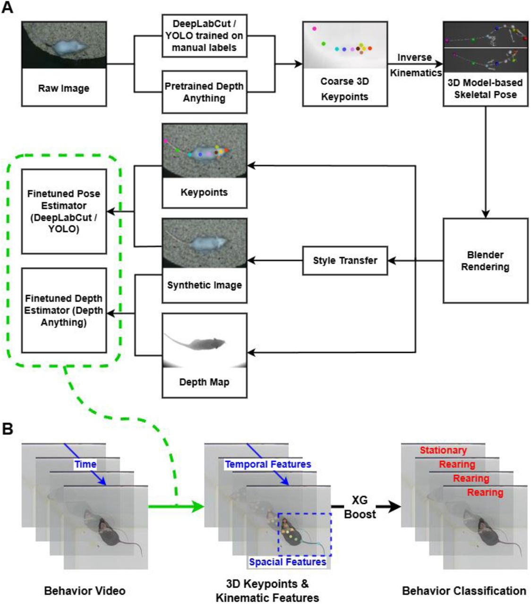

# PyMouse-Lifter
This repository contains the codes and documents of the "PyMouse-Lifter: Real Time 3-D Pose Estimation for Mice with Only 2-D Annotation Via Data Synthesis" project in Dr. Tim Murphy's Lab at UBC.

## Documentation
* [Getting started](docs/GETTING_STARTED.md): from a top-view video to 3D keypoints, features, and a behavior classifier.
* [Using DeepLabCut or SLEAP keypoints](docs/IMPORT_2D_KEYPOINTS.md).
* [Guide for coding assistants](AGENTS.md) (Codex, Claude Code, and similar), including data conventions.
* [Feature definitions](Feature-Definition.md).
## Blender
This folder contains the Blender projects for automated data synthesis. To run the Python scripts in Blender, please install the dependencies in Blender's own Python environment.
## Depth Anything
This folder contains everything you need: getting pseudo labels, fine-tuning models, and doing real-time behavior classification. Synthetic & real datasets are being compressed and uploaded; download links can be found in metric_depth/data/PyMouse_HQ; more data coming.
## PyMouse Lifter Classification
This folder contains the codes and data to validate the behavioral classifiers mentioned in the paper. Details of the features used for classification can be found in Feature-Definition.md
## LED delay measurement
This folder contains the codes and data to validate the delay & FPS estimation with flashing LEDs. To replicate the experiment, go to Depth Anything folder.

